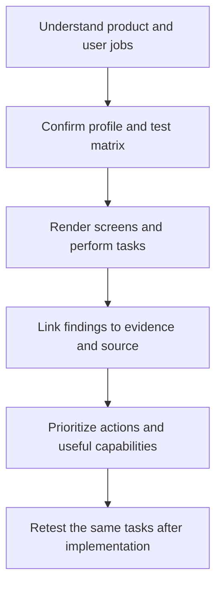

# UI/UX Research Kit

**Turn a local website or web application into an evidence-based plan for outstanding visual design and usability.**

Version **0.3.0** · English kit · Reports in your chosen language · Python **3.10+**

The kit guides a coding agent through source inspection, rendered screens and actual user journeys. Its main deliverable is a prioritized action plan: what works, what causes friction, what to change, which capabilities help, and how to verify improvement.

## WHY

A working frontend can still be confusing, visually generic or difficult to use. Many problems appear only with real content, narrow screens, failed requests or multistep tasks. Connecting screenshots and observed behavior to source locations makes those problems actionable.

- **UI:** art direction, typography, hierarchy, composition, imagery, components and motion.
- **UX:** content, navigation, task completion, forms, feedback, recovery and accessibility.
- **Engineering:** responsive behavior, runtime errors, performance and regression coverage.
- **Traceability:** findings identify route, state, evidence and actual source location.
- **Execution:** actions include steps, dependencies, effort, acceptance criteria and a retest.

Excellence depends on the product, its audience and brand. Technical standards provide measurable requirements; visual and experiential quality also need human design review and appropriate user testing. Trend examples are references, not mandatory styles. Outlooks for 2027 are hypotheses.

## What can I audit?

| Profile | Products | Focus |
| --- | --- | --- |
| `website` | Landing pages, portfolios, corporate sites, content/CMS sites | Understanding, orientation, content, contact and conversion |
| `webapp` | Dashboards, internal tools, SaaS and task-oriented applications | Task success, input, states and recovery |
| `pwa` | Installable web products | Installed mode, safe areas and applicable updates/offline behavior |

The general audit has **31 product criteria**, independent of framework. Static HTML, client-side frontends and server-rendered products are supported. The agent confirms the actual startup path and feature applicability. The optional **45-criterion pipeline/research module** evaluates development workflows, tools and controlled experiments; its desktop/PWA study contract is separate from general product acceptance.

## HOWTO: run an agent-led audit

1. Open the local product in your coding agent.
2. Copy the [GitHub-based local audit prompt](reference/audit-prompt-local-docs.md).
3. Set the requested report language, for example English, German or Spanish.
4. Let the agent inspect the product and collect actual runtime evidence.
5. Review `REPORT.md`, `summary.md` and `action-plan.md` under `docs/ui-ux-audit/<run-id>/`.

That prompt keeps newly saved kit, research and report artifacts within the run directory. It prohibits application edits, dependency/skill installations, commits, branches, pushes and publication. Missing runtime capabilities become explicit investigation tasks.

For an already available kit and a different output location, use [audit-request.md](reference/audit-request.md).



## HOWTO: use the deterministic checker

The Python checker inventories files, validates evidence bindings and generates reports. **The agent or reviewer starts and examines the application.** Python 3.10 or newer is required; the audit scripts use only the standard library.

```sh
git clone https://github.com/scifishelf/ui-ux-research-kit.git
cd ui-ux-research-kit
python3 --version

UIUX_KIT_DIR="$PWD"
UIUX_APP_DIR="/absolute/path/to/webapp"
UIUX_AUDIT_DIR="/tmp/webapp-ui-ux-audit"

PYTHONDONTWRITEBYTECODE=1 python3 "$UIUX_KIT_DIR/skills/web-excellence-audit/scripts/audit.py" \
  --kit "$UIUX_KIT_DIR" \
  --target "$UIUX_APP_DIR" \
  --out "$UIUX_AUDIT_DIR"
cp "$UIUX_KIT_DIR/reference/project.example.json" "$UIUX_AUDIT_DIR/project.json"
```

Replace the example paths. For an enduring report, choose a persistent output directory. An output directory inside the target is supported: pass the **whole run directory** as `--out` so kit copies and evidence are excluded from the inventory.

Edit `project.json` for the actual product; the task-management example is synthetic.

| Field | Meaning |
| --- | --- |
| `profile` / `frontend` | Confirmed profile and relative frontend directory; select explicitly in a monorepo |
| `audience` | Actual audience and usage context |
| `journeys` | Priority tasks, routes, observable success and relevant states |
| `viewports` | Required screen sizes |
| `features` | `true`: present; `false`: verified exclusion; `null`: unresolved |
| `available_capabilities` | Browser, design and testing capabilities actually available |
| `report_language` | Language the agent should use for human-readable deliverables; default English |

Create the scoped baseline:

```sh
PYTHONDONTWRITEBYTECODE=1 python3 "$UIUX_KIT_DIR/skills/web-excellence-audit/scripts/audit.py" \
  --kit "$UIUX_KIT_DIR" \
  --target "$UIUX_APP_DIR" \
  --project "$UIUX_AUDIT_DIR/project.json" \
  --out "$UIUX_AUDIT_DIR"
mkdir -p "$UIUX_AUDIT_DIR/evidence"
cp "$UIUX_AUDIT_DIR/observations.template.json" "$UIUX_AUDIT_DIR/observations.json"
```

Use the project's documented local runtime. Execute the configured tasks and states, **look at the screenshots**, inspect relevant source, and save screenshots, recordings, traces or test logs in the evidence directory. Complete observations using the [evidence contract](reference/universal-audit.md#evidence-contract), [synthetic example](skills/web-excellence-audit/references/observations.example.json) and [schema](skills/web-excellence-audit/references/observations.schema.json).

```sh
PYTHONDONTWRITEBYTECODE=1 python3 "$UIUX_KIT_DIR/skills/web-excellence-audit/scripts/audit.py" \
  --kit "$UIUX_KIT_DIR" \
  --target "$UIUX_APP_DIR" \
  --project "$UIUX_AUDIT_DIR/project.json" \
  --observations "$UIUX_AUDIT_DIR/observations.json" \
  --evidence-root "$UIUX_AUDIT_DIR/evidence" \
  --out "$UIUX_AUDIT_DIR"
```

Source, scope or evidence changes require a real retest. Replacing hashes does not renew an old observation.

## Deliverables and language

| File | Contents |
| --- | --- |
| `REPORT.md` | Agent-authored complete report in the requested language |
| `summary.md` | Scope, status, immediate actions and limitations |
| `gap-report.md` / `audit.json` | Criterion status, inventory, observations and evidence |
| `action-plan.md` / `.json` | Steps, source locations, effort, dependencies, acceptance and retests |
| `tool-recommendations.json` | Needed capabilities and candidates tied to actions |
| `observations.template.json` | Evidence capture template bound to the baseline |

The kit and deterministic checker use English. A coding agent can produce the narrative report and final Markdown deliverables in any language it supports. `report_language` records that preference; **the Python script does not translate text**. Keep JSON field names, criterion IDs, status values, paths and commands stable when translating prose. Preserve evidence and meaning.

| Status | Meaning |
| --- | --- |
| `pass` | Checked and satisfied within the documented scope |
| `fail` | An evidenced deficiency within that scope |
| `unknown` | Missing test, applicability decision or current evidence |
| `not_applicable` | Justified exclusion from confirmed product/feature scope |

A concrete action might repair input lost after a failed save on `/tasks`: name the reproduced failure, its evidence and responsible component, define the error-path change, then retest with input preserved. This is an illustrative example, not an actual product finding.

## Skill recommendations

Start with the observed gap and required capability. Reuse existing tools before recommending installation. Bind design/code skills to actual findings and stack-specific rules to the selected frontend. Each proposal includes an original source, installation option, version/license review and a measurable pilot. Popularity and demos do not establish product effectiveness.

See [capability registry](reference/audit-tools.yaml), [18-entry radar](skill-radar.yaml) and [tool review](reference/tool-review.md). Audit authorization alone does not authorize installation or implementation; respect any separately granted permission.

## Evidence and limits

An audit may contain unresolved criteria. Missing required evidence and known blockers prevent approval. Local traces are not field Core Web Vitals; a mobile desktop viewport is not a real software keyboard or installed PWA. Automated scanning and metadata validation do not prove full accessibility, aesthetics or task success.

The research module contains source-based findings, motion examples and an experiment protocol. Controlled skill comparisons, interviews, panel validation and integrated installed-PWA automation remain pending. No universal effectiveness ranking or excellence certification is claimed.

See [INDEX.md](INDEX.md), [research notes](report/research-notes.md), [validation record](report/evidence/validation.json) and [release notes](CHANGELOG.md).
