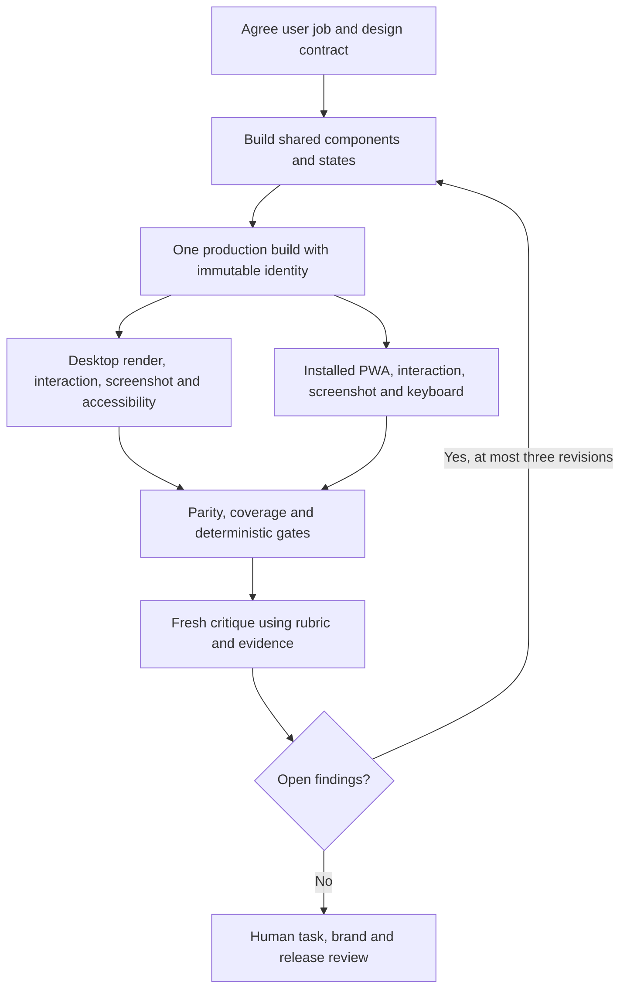

# Reference workflow

Criteria LOOP-01–07, DS-01–04 and UX-01–04. This implementation/review workflow is an optional integration contract; the local audit prompt itself does not authorize product changes.

| Phase | Owner | Input/output | Criteria |
| --- | --- | --- | --- |
| Assignment | Product/design and developer | User job, success, supported routes, critical cases | LOOP-01, UX-01 |
| Design contract | Design engineer and product owner | Tokens, components, breakpoints, motion purposes and allowed variants | DS-01–04 |
| Implementation | Coding agent | Shared state machine and components | UX-02, DS-02 |
| Observation | Tests and runtime adapters | Render, screenshot, DOM, focus, video and trace | LOOP-02/03/06 |
| Critique | Fresh review context | Evidence linked to rubric anchors and criterion IDs | LOOP-04, EVAL-03 |
| Correction | Coding agent | Small patch and new evidence on both applicable surfaces | LOOP-05 |
| Acceptance | Human owner | Actual task, brand fit, open risks and required real-device checks | PWA-08, ACC-01 |

Preserve existing project rules and approved wording, colors and behavior. Involve the responsible human for major design decisions, conflicts, uncertain criticism, after three unsuccessful revisions and at final acceptance. A separate subagent is optional, not required; a fresh evidence-based review context can serve the critic role.

Deterministic gates exclude known error classes. An unvalidated aesthetic score cannot authorize a release. For a general website/webapp use its applicable runtime matrix; dual-surface PWA obligations apply only to the selected research/product scope.
